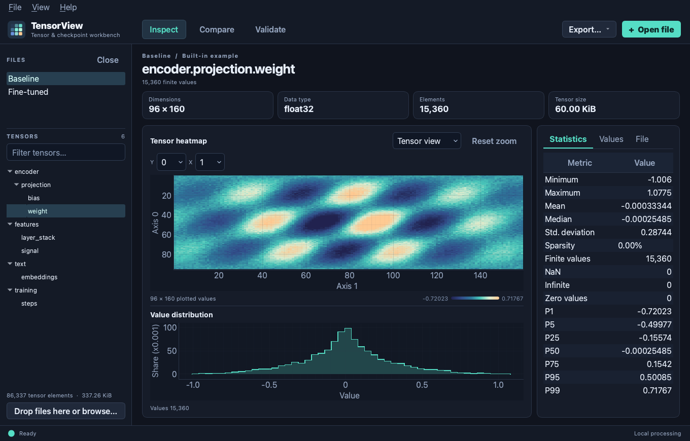

# TensorView

TensorView is a desktop workbench for inspecting, comparing, validating, and converting tensors and machine learning checkpoints. It reads local files and runs on the CPU.



## Start TensorView

On this Mac, open **dist/TensorView.app** if you have built the app, or double-click **Launch TensorView.command** to start it from the project’s Python environment.

To install from source on macOS, Windows, or Linux, use Python 3.11–3.14. Python 3.12 is the baseline for the cross-platform builds.

```sh
python -m venv .venv
# macOS or Linux
source .venv/bin/activate
# On Windows PowerShell, use .venv\Scripts\Activate.ps1 instead
python -m pip install -e '.[torch,scientific,embeddings]'
tensorview
```

A base install, `python -m pip install -e .`, supports NumPy and SafeTensors. Add `torch` for PyTorch, `scientific` for HDF5, ONNX and MATLAB, and `embeddings` for projections. A CPU-only PyTorch build is sufficient. To skip the built-in examples or open local files from the terminal, use `tensorview --empty` or `tensorview model.safetensors`.

## Explore a checkpoint

1. Drag files into the window or use **Open file**. Select a tensor in the searchable explorer to see its shape, dtype, element count, logical tensor bytes, interactive plot, distribution, statistics, and raw values. The **File** tab shows source metadata and any reader notes.
2. Select the row and column axes for a tensor with two or more dimensions. Set indices for the other axes to change the slice. Use PCA, t-SNE, or UMAP for a 2D embedding matrix. Drag to pan and scroll to zoom.
3. In **Compare**, choose a baseline and a candidate. Run the comparison, then select a row to overlay the distributions or inspect both tensor slices side by side. Names are matched exactly, including nested paths. Comparison is directional, so added and removed tensors are relative to the baseline.
4. In **Validate**, select a file and run the scan. Double-click a tensor finding to inspect it. NaN and infinity are errors. High sparsity, constant or zero tensors, and magnitude above 1,000,000 are review signals. Mixed floating-point precision and unsupported entries are informational.
5. Use **Export** to convert or extract the selected tensor, save a CSV, JSON, or HTML report, or save a plot to a 2,400-pixel-wide PNG. Apply a transpose, reshape, or dtype change during conversion.

The included Baseline and Fine-tuned checkpoints are synthetic. They contain examples of a weight matrix, a signal, a tensor with fixed slice axes, an embedding matrix, and changed or added tensors.

## Formats

| Format | Read | Export selected tensor |
| --- | --- | --- |
| NumPy `.npy` and `.npz` | Dense numerical arrays | Yes |
| SafeTensors `.safetensors` | Dense numerical weights, including supported BF16/FP8 types | Yes, using the selected or decoded dtype |
| PyTorch `.pt`, `.pth` | Tensor and state-dictionary checkpoints | `.pt` state dictionary |
| HDF5 `.h5`, `.hdf5` | Nested numerical datasets | `.h5` |
| ONNX `.onnx` | Dense graph initializers, tensor-valued node attributes, and model metadata | Extract to any compatible export format |
| MATLAB `.mat` | Numerical variables, including HDF5-based v7.3 files | MATLAB level 5 with SciPy |
| CSV `.csv` | — | Values with zero-based indices |

Object arrays, sparse or quantized PyTorch layouts, TorchScript, and pickled Python model objects are outside the reader’s scope. HDF5 external and virtual datasets are skipped. ONNX external weights must live in a regular file alongside the model, and packed 4-bit weights are outside the reader’s scope. MATLAB cells, structs, and sparse variables are skipped. The File tab lists entries omitted by a reader where applicable.

## Numerical methods and file handling

- Tensor values are scanned in blocks. Counts, sparsity, extrema, and pairwise value changes scan all entries. Means, population standard deviations, and distance metrics use floating-point accumulation. For complex tensors, plots and summary statistics use magnitude and comparison uses complex differences and the real part of cosine similarity.
- Median, percentiles, and histograms use up to 65,536 evenly spaced entries. The Values tab shows the first 2,048 elements in row-major order and supports lookup by flat index or coordinates. Heatmaps show up to 384 samples per axis, signals up to 4,096 points, and embedding views use up to 2,000 rows and 512 features. Embedding rows with non-finite sampled features are omitted.
- Comparison reports list total altered positions and calculate numerical distances over pairs where both values are finite. Matched NaN components count as equal. Relative L2 is the norm of the difference divided by the baseline norm. Relative L2 and cosine are unavailable when their denominator is zero, except an identical finite zero pair has zero relative L2. Use the training configuration to determine whether an unchanged layer was frozen.
- NPY and SafeTensors weights are memory-mapped. NPZ members are extracted individually to a temporary directory and mapped when accessed. HDF5 is read by slice. Modern PyTorch checkpoints use CPU memory mapping with `weights_only=True` and no added pickle allowlists. Older PyTorch serialization and formats that require eager materialization have documented per-input limits of 512 MiB where applicable. Temporary export staging requires free space on the destination volume.
- TensorView performs file reads and numerical analysis on your device. Open files from sources you trust because the underlying format parsers are not isolated from the application process.

## Development and builds

```sh
python -m pip install -e '.[torch,scientific,embeddings,dev]'
python -m pytest
ruff check .
python -m PyInstaller --noconfirm packaging/TensorView.spec
```

PyInstaller builds a native app for the host platform. macOS produces `dist/TensorView.app`. Windows and Linux produce an application folder under `dist/TensorView`. The GitHub Actions workflow runs tests on all three platforms. A manual run or `v*` tag also builds, verifies, and uploads app archives. The macOS app is built locally with ad-hoc signing. Public notarization or Windows signing requires a distribution certificate.

Released under the [MIT License](LICENSE).
